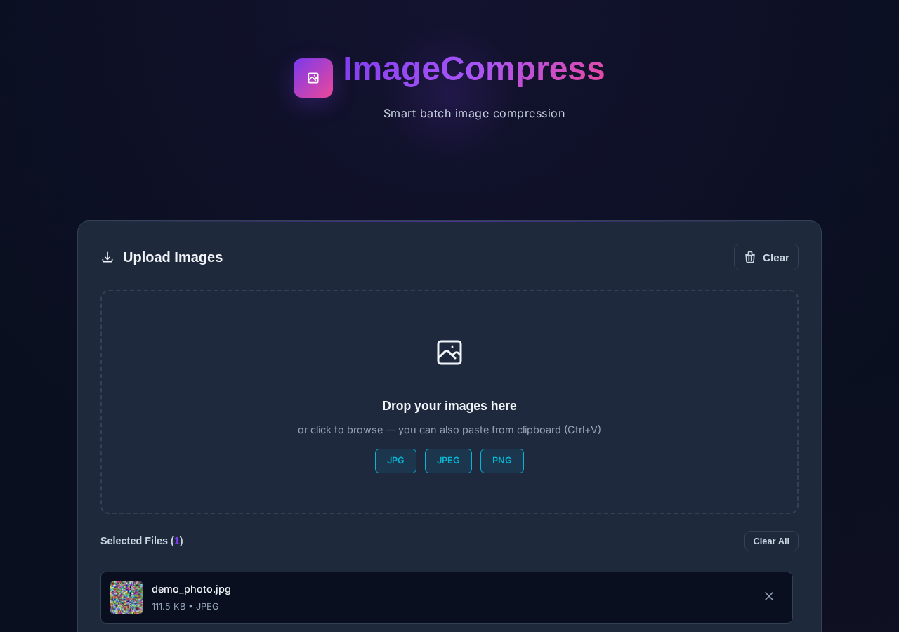
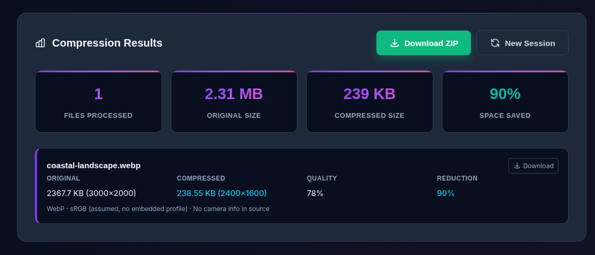

# ImageCompress

Batch-compress JPG and PNG images to a target file size in your browser. No upload to third parties — everything runs locally.

[](https://hub.docker.com/r/anderskeis/pycompressweb)



## Quick Start

```bash
# Run with Docker (recommended)
docker run -d -p 5050:5050 anderskeis/pycompressweb:latest
```

Open **http://localhost:5050** and start compressing.

### Other options

```bash
# Docker Compose (from source)
git clone https://github.com/anderskeis/pycompressweb.git
cd pycompressweb && docker compose up -d

# Local development (no Docker)
pip install -r requirements.txt && python app.py
```

## How to Use

1. **Drop images** onto the upload zone (or click to browse, or paste with Ctrl+V)
2. **Set target size** in KB — use presets (50/100/200/500 KB, 1 MB) or enter custom
3. **Pick output format**: Keep Original, Convert to JPG, or Convert to PNG
4. Click **Compress Images** (or press Ctrl+Enter)
5. **Download** — get all files as ZIP, or download individual images
6. Click **New Session** to start fresh

**Shortcuts**: Ctrl+V paste · Esc clear files · Ctrl+Enter compress



## Features

- Batch upload: drag & drop, file picker, or clipboard paste
- Image thumbnails with total size indicator (500 MB limit)
- Smart compression: binary search on quality (25–95%) then resolution scaling
- EXIF orientation preserved — rotated photos stay upright
- Per-file results: original vs compressed size, resolution, quality, reduction %
- Download all as ZIP or individual files
- Auto-cleanup of temporary files after 1 hour

## ⚠️ Security Warning

**LOCAL USE ONLY.** No authentication, no rate limiting. Do not expose to the public internet.

## Configuration

| Setting | Default | Description |
|---------|---------|-------------|
| Port | 5050 | Web server port |
| Max Upload | 500 MB | Maximum total upload size |
| Min Quality | 25% | Quality floor (never goes below) |
| Max Quality | 95% | Maximum quality |
| Session Cleanup | 1 hour | Auto-delete temporary files |
| LOG_LEVEL | INFO | DEBUG, INFO, WARNING, or ERROR |

Set `LOG_LEVEL` via environment variable: `docker run -e LOG_LEVEL=DEBUG -p 5050:5050 anderskeis/pycompressweb:latest`

## Tech Stack

Python 3.11 · Flask · Pillow · Gunicorn · Vanilla HTML/CSS/JS · Docker (amd64/arm64)

## License

Do whatever you want :)
